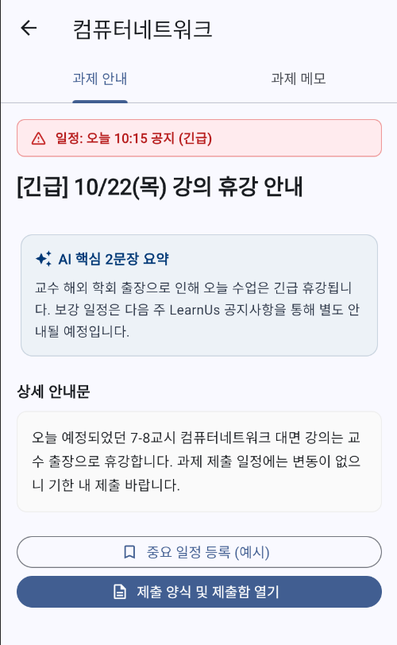
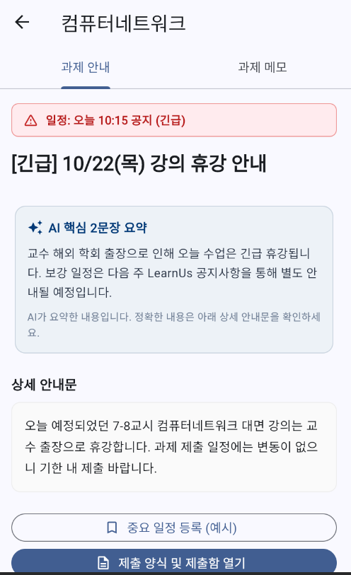
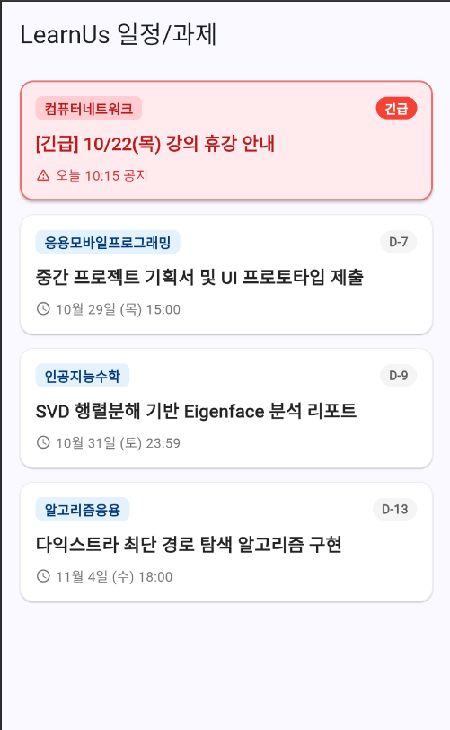
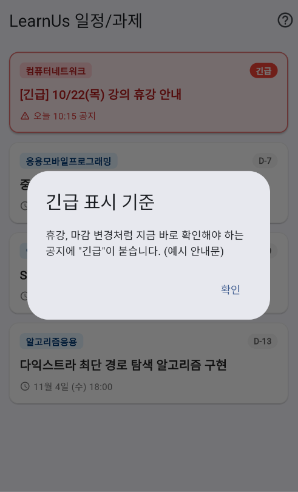
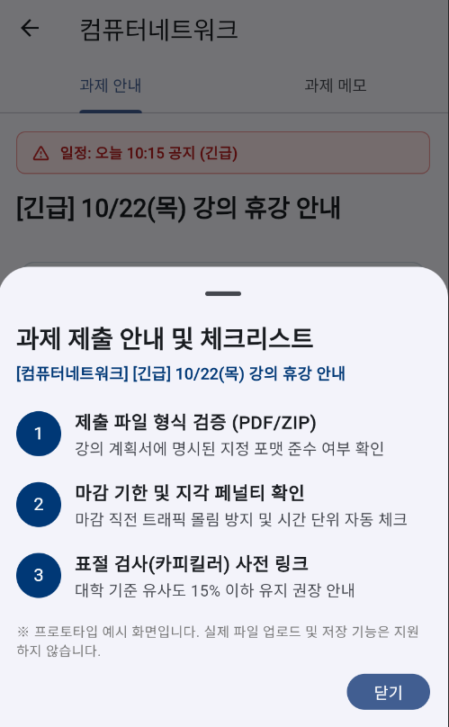

# 셀프 논증 기록 (제출물 ① 저장소 `docs/` · 20점)

> 1인 과제이므로 "협업" 대신 **스스로 논증**합니다. 내 설계 결정마다 **AI를 반론자로 세워** 약점을 공격받고, 다시 반박하거나 고쳐서 결론을 냅니다.
> 구조(쟁점마다): **내 주장 → 반론(AI · 나) → 재반론 · 수정 → 결론(유지 · 수정 · 폐기) → 근거(원칙 P번호 · 리뷰) → 전 · 후 화면**
> 이론: Toulmin 논증 모형(1958, *The Uses of Argument*) — 주장 · 근거 · 보증 · **반론**. 반론을 견딘 주장이 근거 있는 결정입니다.
> 증거: `docs/prompt-log.md`에서 AI에게 반론을 요청한 줄(날짜) · `docs/원칙카드.md`의 P번호. "AI가 그렇게 해서"는 근거가 아닙니다.
> 전·후 기준점: 각 쟁점의 "전"은 고치기 전 화면 캡처, "후"는 고친 뒤 화면 캡처입니다.

작성자: H.D. · 사용한 AI 도구: Claude

## AI에게 반론을 요청하는 법 (예)
- "이 화면(A 목록) 설계의 약점을 닐슨 원칙 번호로 3개 반박해 줘. 칭찬은 빼고."
- "내가 고른 '오류 시 ErrorView + 다시 시도'에 반대하는 입장에서 논증해 줘."
- 요청과 AI 답은 `docs/prompt-log.md`에 한 줄로 남기고, 아래 표의 증거 칸에 그 줄을 적습니다.

## 쟁점 목록

쟁점은 3개, 하나에 한 행입니다.

| # | 쟁점 (화면 · 요소 번호) | 내 주장 | 반론 (AI · 나) | 재반론 · 수정 | 결론 | 근거 (원칙 P번호 · 리뷰) | 전 · 후 화면 | 증거 (prompt-log · 원칙 카드) |
|---|---|---|---|---|---|---|---|---|
| 1 | 공지를 열면 무엇을 먼저 보여 줄까 (B-3) | 긴 안내문 위에 "AI 핵심 2문장 요약" 카드를 먼저 보여 준다 | (AI) 요약이 지각 감점·제출 형식 같은 핵심 조건을 빼먹으면 사용자가 불완전한 정보로 행동하고, AI가 만든 글이라는 표시도 없다 — P01, P05 · (나) 요약이 틀리면 학점에 불이익이 생길 수 있다 | 요약은 유지하되 "AI가 요약한 내용입니다. 정확한 내용은 아래 상세 안내문을 확인하세요." 한 줄을 요약 카드 안에 추가한다. 상세 안내문은 요약 바로 아래에 있어 정보가 숨겨지지 않는다 | **수정** | P08(핵심 먼저) · P01(AI 결과임을 표시) · 리뷰 "학점과 직결되는 문제들인데 앱만 믿었다간 학점에 흠결이 갈 수 있습니다" — ★1 · 2025-03-18 | 전 `screenshots/i1_before.png` → 후 `screenshots/i1_after.png` | prompt-log 1행 · 원칙 카드 P08 |
| 2 | 긴급 공지를 어떻게 구분하고 설명할까 (A-2 · A-7) | `isAlert`인 항목만 빨간 카드·"긴급" 뱃지·경고 아이콘으로 눈에 띄게 한다 | (AI) 빨간색을 자주 쓰면 경고 피로가 생기고, 색만으로 구분하면 색약 사용자가 놓친다 — P01, P04 · (나) "긴급"이 무엇을 뜻하는지 기준이 화면 어디에도 설명되어 있지 않다 | AI 반론은 이미 경고 아이콘과 "긴급" 글자를 함께 쓰고 빨간색을 긴급 항목에만 쓰므로 받아들이지 않는다. 내 반론은 맞다 → 앱바에 "?" 버튼(A-7)을 추가해 누르면 긴급 표시 기준을 안내창으로 설명한다 | **수정** | P01(긴급 상태 가시화) · P10(도움말) · 리뷰 "푸시알림안오고 … 과제 기한 못맞춤" — ★1 · 2023-06-14 | 전 `screenshots/i2_before.png` → 후 `screenshots/i2_after.png` | prompt-log 2행 · 원칙 카드 P01 |
| 3 | 제출 체크리스트를 어디에 보여 줄까 (C-1) | 새 화면이 아니라 모달 바텀시트로 덮어서 보여 준다 | (AI) 시트는 바깥을 누르거나 아래로 밀면 바로 닫혀서 과제를 하면서 계속 볼 수 없다 — P06 · (나) 바깥을 눌렀을 때 시트가 너무 쉽게 닫힌다 | 쉽게 닫히는 것은 의도다. 항목이 3개뿐이라 새 화면은 과하고, 다시 열기도 버튼 한 번이다. 시트 뒤에 공지 제목이 그대로 보여 맥락이 유지되고, 손잡이와 "닫기" 버튼으로 나가는 길이 분명하다 | **유지** | P03(통제와 자유: 쉬운 닫기) · P07(버튼 한 번으로 열기) | 전 `screenshots/03_v2_b.png` → 후 `screenshots/04_v2_c.png` | prompt-log 3행 · 원칙 카드 P03 |

- **결론**: 유지(반론을 반박하고 그대로 감 — 반박 근거 필요) · 수정(반론을 받아 고침) · 폐기(주장을 버림 — 왜).
- 반론 없이 내 주장만 있으면 논증이 아닙니다. AI 반론을 그대로 받기만 하고 재반론이 없어도 약합니다.
- 옆 사람 · 강사 클리닉에서 받은 의견도 반론으로 적을 수 있습니다.

## 전 · 후 화면 (쟁점별)

### 쟁점 1 — AI 2문장 요약에 "AI가 만든 글" 표시 추가 (B-3)

| 전 | 후 |
|---|---|
|  |  |

- 관련 커밋: `git log --oneline --grep="p08"` · 원칙 카드: P08 · prompt-log: 1행

### 쟁점 2 — 긴급 표시 기준을 설명하는 "?" 버튼 추가 (A-2 · A-7)

| 전 | 후 |
|---|---|
|  |  |

- 관련 커밋: `git log --oneline --grep="p01"` · 원칙 카드: P01 · prompt-log: 2행

### 쟁점 3 — 제출 체크리스트는 모달 시트로 유지 (C-1)

| 전 | 후 |
|---|---|
|  |  |

- 관련 커밋: `git log --oneline --grep="p03"` · 원칙 카드: P03 · prompt-log: 3행